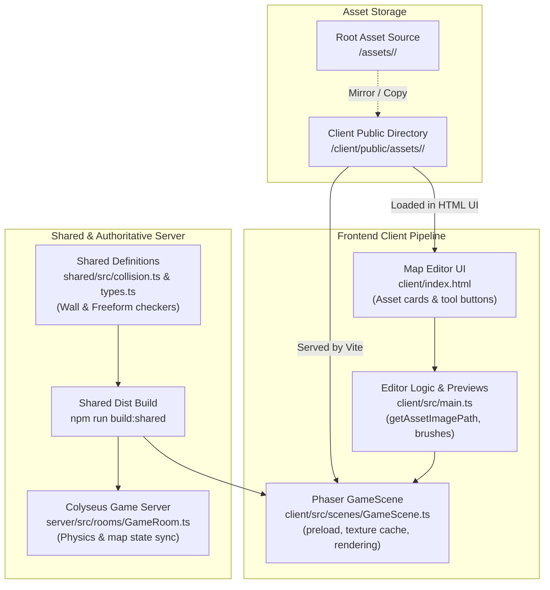
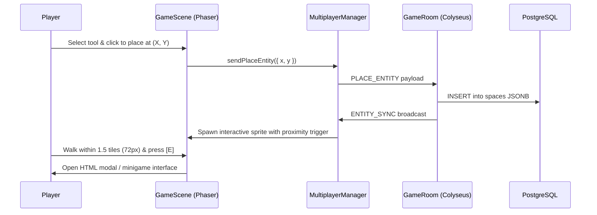

# Developer Guide: Adding New Assets into Lepark

Welcome to the **Lepark Asset Integration Guide**. This document provides an exhaustive, step-by-step walkthrough for developers to add new assets—such as floor tiles, solid walls, overlay walls, grid-bounded decorations, freeform props, interactive entities, and character sprites—into the Lepark engine.

---

## Table of Contents

1. [Asset Architecture & Pipeline Overview](#1-asset-architecture--pipeline-overview)
2. [Asset Categories & Directory Layout](#2-asset-categories--directory-layout)
3. [Technical Specifications & Art Guidelines](#3-technical-specifications--art-guidelines)
4. [Adding a New Floor Tile (Flooring Patterns)](#4-adding-a-new-floor-tile-flooring-patterns)
5. [Adding a New Wall Tile (Solid vs. Overlay)](#5-adding-a-new-wall-tile-solid-vs-overlay)
6. [Adding a New Grid Decoration](#6-adding-a-new-grid-decoration)
7. [Adding a New Freeform Decoration (Continuous Coordinate Props)](#7-adding-a-new-freeform-decoration-continuous-coordinate-props)
8. [Adding an Interactive Entity (e.g., Jukebox, Arcade/Minigame Machine)](#8-adding-an-interactive-entity-eg-jukebox-arcademinigame-machine)
9. [Adding Character Sprites & Animation Atlases](#9-adding-character-sprites--animation-atlases)
10. [End-to-End Developer Checklist & Verification](#10-end-to-end-developer-checklist--verification)
11. [Troubleshooting & Common Pitfalls](#11-troubleshooting--common-pitfalls)

---

## 1. Asset Architecture & Pipeline Overview

Lepark is built with **Phaser 3 (WebGL Engine)** on the client, **Colyseus (WebSocket)** on the server, and a **Shared TypeScript Library (`shared/`)** for collision validation and schemas.



### Key Architectural Concepts

1. **Dual Directory Requirement:**
   - Source repository: [`/assets/<category>/`](file:///Users/firdausfadzi/Desktop/game/assets/)
   - Vite public folder: [`/client/public/assets/<category>/`](file:///Users/firdausfadzi/Desktop/game/client/public/assets/)
   > [!IMPORTANT]
   > Vite serves assets statically from `/client/public/`. Any image loaded by Phaser via `/assets/...` or rendered in the HTML editor modal must exist inside [`client/public/assets/`](file:///Users/firdausfadzi/Desktop/game/client/public/assets/). Always keep both folders synchronized.

2. **Shared Package Invalidation:**
   - Any modification to [`shared/src/collision.ts`](file:///Users/firdausfadzi/Desktop/game/shared/src/collision.ts) or [`shared/src/types.ts`](file:///Users/firdausfadzi/Desktop/game/shared/src/types.ts) requires running `npm run build:shared` (or `npm run build`) so both `client` and `server` compile against the latest collision rules.

---

## 2. Asset Categories & Directory Layout

The asset library is divided into the following categories:

```
lepark/
├── assets/                               # Project-wide source assets
│   ├── floor/                            # Flooring tile patterns (wood, stone, carpet, etc.)
│   ├── wall/                             # Wall textures (solid wood walls, glass walls, etc.)
│   ├── decoration/                       # Furniture, props, jukebox, typewriter, etc.
│   ├── 16x32_idle_sheet.png              # Character idle animation sheet
│   ├── 16x32_walk_sheet.png              # Character walk animation sheet
│   ├── idle_sprites_mapping.json         # TexturePacker atlas map for idle
│   └── walk_sprites_mapping.json         # TexturePacker atlas map for walk
└── client/
    └── public/
        └── assets/                       # Vite static public mirror of assets/
            ├── floor/
            ├── wall/
            ├── decoration/
            └── ...
```

---

## 3. Technical Specifications & Art Guidelines

| Category | World Grid Size | Recommended Source Resolution | Format | Color Space / Alpha | Notes |
| :--- | :--- | :--- | :--- | :--- | :--- |
| **Floor Tiles** | $50 \times 50\text{ px}$ | $96 \times 96\text{ px}$ or $50 \times 50\text{ px}$ | PNG | RGBA (8-bit) | Seamless tiling or clean borders. Snaps to grid. |
| **Solid Walls** | $50 \times 50\text{ px}$ | $96 \times 96\text{ px}$ or $50 \times 50\text{ px}$ | PNG | RGBA (8-bit) | Replaces floor tile; automatically creates impassable obstacle. |
| **Overlay Walls** | $50 \times 50\text{ px}$ | $96 \times 96\text{ px}$ or $50 \times 50\text{ px}$ | PNG (transparent) | RGBA (8-bit) | Renders on top of existing floor; impassable by default. |
| **Grid Decorations** | $50 \times 50\text{ px}$ (or mult-tile) | $96 \times 96\text{ px}$ or $150 \times 150\text{ px}$ | PNG (transparent) | RGBA (8-bit) | Snapped to grid cells. Passable or solid toggleable. |
| **Freeform Props** | Variable ($50\times 50\text{ px}$ default) | $150 \times 150\text{ px}$ | PNG (transparent) | RGBA (8-bit) | Unbounded placement ($X, Y$ coordinates). |
| **Interactive Props**| $48 \times 48\text{ px}$ to $60 \times 60\text{ px}$| $150 \times 150\text{ px}$ | PNG (transparent) | RGBA (8-bit) | Freeform placement with proximity prompt ([E]). |
| **Character Sprites**| $16 \times 25\text{ px}$ (scaled to $\le 60\text{ px}$) | $16 \times 32\text{ px}$ per frame | PNG | RGBA (8-bit) | Nearest-neighbor pixel art; 4 directions + idle. |

> [!TIP]
> Keep `image-rendering: pixelated` in mind. Crisp, non-anti-aliased pixel borders look best under Phaser's nearest-neighbor WebGL filtering.

---

## 4. Adding a New Floor Tile (Flooring Patterns)

Follow this 4-step procedure when adding a new floor pattern (e.g. `stone_9` or `carpet_9`):

### Step 1: Save Images to Disk
Place your PNG file in both asset locations:
1. `assets/floor/<asset_id>.png`
2. `client/public/assets/floor/<asset_id>.png`

### Step 2: Register in GameScene Preload
Open [`client/src/scenes/GameScene.ts`](file:///Users/firdausfadzi/Desktop/game/client/src/scenes/GameScene.ts) and add the key to `floorAssets`:

```typescript
// client/src/scenes/GameScene.ts -> preload()
const floorAssets = [
  "carpet_1", "carpet_2", "carpet_3", "carpet_4", "carpet_5", "carpet_6", "carpet_7", "carpet_8",
  "grass_1", "grass_2", "grass_3", "grass_4",
  "marble_1", "marble_2", "marble_3", "marble_4",
  "stone_1", "stone_2", "stone_3", "stone_4", "stone_5", "stone_6", "stone_7", "stone_8",
  "wood_1", "wood_2", "wood_3", "wood_4", "wood_5", "wood_6",
  "stone_9", // <-- Add new asset ID here
];
```

### Step 3: Register in Editor Helper
Open [`client/src/main.ts`](file:///Users/firdausfadzi/Desktop/game/client/src/main.ts) and add `<asset_id>` to `getAssetImagePath()`:

```typescript
// client/src/main.ts -> getAssetImagePath()
const floorAssets = new Set([
  "carpet_1", "carpet_2", "carpet_3", "carpet_4", "carpet_5", "carpet_6", "carpet_7", "carpet_8",
  "grass_1", "grass_2", "grass_3", "grass_4",
  "marble_1", "marble_2", "marble_3", "marble_4",
  "stone_1", "stone_2", "stone_3", "stone_4", "stone_5", "stone_6", "stone_7", "stone_8",
  "wood_1", "wood_2", "wood_3", "wood_4", "wood_5", "wood_6",
  "stone_9" // <-- Add here
]);
```

### Step 4: Add Asset Card to Map Editor HTML
Open [`client/index.html`](file:///Users/firdausfadzi/Desktop/game/client/index.html) and locate the Flooring tab panel (`data-category="flooring"`). Add the button card:

```html
<!-- client/index.html -->
<button
  type="button"
  class="editor-asset-card"
  data-asset-id="stone_9"
  data-asset-name="Stone 9"
  title="Stone Floor 9 (stone_9)"
>
  <div class="asset-card-thumb">
    
    <span class="asset-card-check">✓</span>
  </div>
  <div class="asset-card-info">
    <span class="asset-card-name">Stone 9</span>
    <span class="asset-card-code">stone_9</span>
  </div>
</button>
```

Update the counter in the header:
```html
<span class="category-count">33 styles</span>
```

---

## 5. Adding a New Wall Tile (Solid vs. Overlay)

Walls can either completely replace the underlying floor tile (**Solid Wall**) or render above the floor tile while maintaining transparency (**Overlay Wall**, like glass railings or translucent wood slats).

### Step 1: Place Image Files
1. `assets/wall/<asset_id>.png`
2. `client/public/assets/wall/<asset_id>.png`

### Step 2: Register in Shared Collision Logic
Open [`shared/src/collision.ts`](file:///Users/firdausfadzi/Desktop/game/shared/src/collision.ts):

1. Add your key to `WALL_ASSET_KEYS`:
   ```typescript
   export const WALL_ASSET_KEYS = [
     "glass_1", "glass_2", "glass_3", "glass_4",
     "wood_wall_1", "wood_wall_2", ...,
     "my_new_wall_1", // <-- Add here
     "obstacle",
   ] as const;
   ```
2. Update `isWallAsset`:
   ```typescript
   export function isWallAsset(key: string | undefined | null): boolean {
     if (!key) return false;
     const baseKey = key.includes("|") ? key.split("|")[0] : key;
     return (
       // ... existing checks ...
       baseKey === "my_new_wall_1"
     );
   }
   ```
3. *(If Overlay Wall)* Update `isOverlayWallAsset`:
   ```typescript
   export function isOverlayWallAsset(key: string | undefined | null): boolean {
     if (!key) return false;
     const baseKey = key.includes("|") ? key.split("|")[0] : key;
     return (
       baseKey === "glass_2" ||
       baseKey === "wood_wall_2" ||
       baseKey === "my_new_wall_1" // <-- Add here if overlay
     );
   }
   ```

### Step 3: Rebuild the Shared Package
Run the workspace build script from project root:
```bash
npm run build:shared
```

### Step 4: Register in GameScene Preload
In [`client/src/scenes/GameScene.ts`](file:///Users/firdausfadzi/Desktop/game/client/src/scenes/GameScene.ts):
```typescript
const wallAssets = [
  "glass_1", "glass_2", "glass_3", "glass_4",
  "my_new_wall_1"
];
for (const wa of wallAssets) {
  this.load.image(wa, `/assets/wall/${wa}.png`);
}
```

### Step 5: Register in Editor Helper (`main.ts`)
In [`client/src/main.ts`](file:///Users/firdausfadzi/Desktop/game/client/src/main.ts):
```typescript
// Inside getAssetImagePath()
if (normalized === "my_new_wall_1") {
  return `/assets/wall/my_new_wall_1.png`;
}
```

### Step 6: Add to Map Editor HTML Palette
In [`client/index.html`](file:///Users/firdausfadzi/Desktop/game/client/index.html) under the Wall category (`data-category="walls"`):

**For Solid Wall:**
```html
<button
  type="button"
  class="editor-asset-card"
  data-asset-id="my_new_wall_1"
  data-asset-name="My Solid Wall 1"
  data-is-wall="true"
  title="My Solid Wall 1 - Solid wall with Obstacle tile."
>
  <div class="asset-card-thumb">
    
    <span class="asset-card-badge wall-badge">Wall</span>
    <span class="asset-card-check">✓</span>
  </div>
  <div class="asset-card-info">
    <span class="asset-card-name">My Wall 1</span>
    <span class="asset-card-code">my_new_wall_1</span>
  </div>
</button>
```

**For Overlay Wall (renders on top of existing floor):**
```html
<button
  type="button"
  class="editor-asset-card"
  data-asset-id="my_new_overlay_wall_1"
  data-asset-name="My Glass Railing"
  data-is-wall="true"
  data-is-overlay-wall="true"
  title="My Glass Railing - Overlay wall on top of floor."
>
  <div class="asset-card-thumb">
    
    <span class="asset-card-badge wall-badge" style="background:#2563eb;">Overlay</span>
    <span class="asset-card-check">✓</span>
  </div>
  <div class="asset-card-info">
    <span class="asset-card-name">Glass Railing</span>
    <span class="asset-card-code">my_new_overlay_wall_1</span>
  </div>
</button>
```

---

## 6. Adding a New Grid Decoration

Grid decorations are bounded by the $50\times 50\text{ px}$ tile grid (e.g. modular table sections, floor plants, carpets, rugs).

### Step 1: Place Image Files
1. `assets/decoration/<asset_id>.png`
2. `client/public/assets/decoration/<asset_id>.png`

### Step 2: Register in GameScene Preload
In [`client/src/scenes/GameScene.ts`](file:///Users/firdausfadzi/Desktop/game/client/src/scenes/GameScene.ts):
```typescript
const decoAssets = [
  "table_1_left", "table_1_middle", "table_1_right",
  "table_2_left", "table_2_middle", "table_2_right",
  "round_table_1", "office_chair_1_front", "office_chair_1_back",
  "jukebox_1", "typewriter_1",
  "plant_pot_1", // <-- Add your asset key
];
for (const da of decoAssets) {
  this.load.image(da, `/assets/decoration/${da}.png`);
}
```

### Step 3: Register in Editor Helper (`main.ts`)
In [`client/src/main.ts`](file:///Users/firdausfadzi/Desktop/game/client/src/main.ts):
```typescript
// Inside getAssetImagePath()
const decoAssets = new Set([
  // ... existing items ...
  "plant_pot_1",
]);
```

### Step 4: Add Asset Card to Map Editor HTML
In [`client/index.html`](file:///Users/firdausfadzi/Desktop/game/client/index.html) under the Decoration category (`data-category="decoration"`):

```html
<button
  type="button"
  class="editor-asset-card"
  data-asset-id="plant_pot_1"
  data-asset-name="Potted Fern"
  data-tile-type="decoration"
  title="Potted Fern (plant_pot_1) - Grid-aligned decoration"
>
  <div class="asset-card-thumb">
    
    <span class="asset-card-badge decoration-badge">Deco</span>
    <span class="asset-card-check">✓</span>
  </div>
  <div class="asset-card-info">
    <span class="asset-card-name">Potted Fern</span>
    <span class="asset-card-code">plant_pot_1</span>
  </div>
</button>
```

> [!NOTE]
> Grid decorations automatically inherit the Editor's active settings:
> - **Collision**: Passable (walkable) or Solid (obstacle)
> - **Render Layer**: Behind character (floor-level) or On Top of character (overhead canopy)
> - **Layer Level**: Layer 0, 1, 2... (controlled via Up/Down arrow keys)

---

## 7. Adding a New Freeform Decoration (Continuous Coordinate Props)

Freeform props are **not** bounded by the grid. They can be placed anywhere at continuous pixel coordinates $(X, Y)$ (drag-and-drop or point-and-click), like chairs, couches, cushions, or tabletop accessories.

### Step 1: Place Image Files
1. `assets/decoration/<asset_id>.png`
2. `client/public/assets/decoration/<asset_id>.png`

### Step 2: Register in Shared Types (`shared/src/types.ts`)
Freeform assets require server and client agreement:
```typescript
// shared/src/types.ts
export const FREEFORM_ASSET_KEYS = [
  "office_chair_1_front",
  "office_chair_1_back",
  "office_chair_150",
  "office_chair_back_150",
  "couch_red_front", // <-- Add key
] as const;

export function isFreeformAsset(assetKey: string | undefined | null): boolean {
  if (!assetKey) return false;
  const baseKey = assetKey.includes("|") ? assetKey.split("|")[0] : assetKey;
  return (
    baseKey === "office_chair_1_front" ||
    baseKey === "office_chair_1_back" ||
    baseKey === "couch_red_front" // <-- Add check
  );
}
```

### Step 3: Rebuild Shared Package
```bash
npm run build:shared
```

### Step 4: Register in GameScene Preload
In [`client/src/scenes/GameScene.ts`](file:///Users/firdausfadzi/Desktop/game/client/src/scenes/GameScene.ts):
```typescript
// In decoAssets list:
"couch_red_front",
```

### Step 5: Register in `client/src/main.ts`
Add to `decoAssets` Set inside `getAssetImagePath(assetId: string)`.

### Step 6: Add Freeform Button Card in HTML
In [`client/index.html`](file:///Users/firdausfadzi/Desktop/game/client/index.html):
```html
<button
  type="button"
  class="editor-asset-card"
  data-asset-id="couch_red_front"
  data-asset-name="Red Couch"
  data-tile-type="decoration"
  data-freeform="true"
  title="Red Couch (couch_red_front) - Freeform decoration (continuous X,Y placement)"
>
  <div class="asset-card-thumb">
    
    <span class="asset-card-badge freeform-badge">Freeform</span>
    <span class="asset-card-check">✓</span>
  </div>
  <div class="asset-card-info">
    <span class="asset-card-name">Red Couch</span>
    <span class="asset-card-code">couch_red_front</span>
  </div>
</button>
```

> [!IMPORTANT]
> The `data-freeform="true"` attribute on the button card is what tells `main.ts` to switch the tool to `freeform_decoration` mode and activate the floating placement ghost.

---

## 8. Adding an Interactive Entity (e.g., Jukebox, Arcade/Minigame Machine)

Interactive entities are complex world objects with custom state sync, proximity interaction (pressing `[E]`), and UI modals. Examples in Lepark include the **YouTube Jukebox** and **Typerace Typewriter**.

### Architecture Pattern for Interactive Objects



### Step-by-Step Implementation

1. **Place Asset Image:**
   - Save to `assets/decoration/<entity_name>_1.png` and `client/public/assets/decoration/<entity_name>_1.png`.
2. **Preload in GameScene:**
   - `this.load.image("<entity_name>_1", "/assets/decoration/<entity_name>_1.png");`
3. **Define Shared State (`shared/src/types.ts`):**
   - Define entity schema (e.g. `id`, `x`, `y`, `spaceId`, state attributes).
   - Define payload types: `PlacePayload`, `UpdatePayload`, `DeletePayload`.
4. **Create Placement Ghost & Proximity Zone (`GameScene.ts`):**
   - Add ghost preview image (`setDisplaySize(48, 48)`, `setAlpha(0.65)`).
   - Check proximity in the `update()` loop:
     ```typescript
     const dist = Phaser.Math.Distance.Between(player.x, player.y, entity.x, entity.y);
     if (dist <= 1.5 * TILE_SIZE) {
       // Display [Press E] prompt
     }
     ```
5. **Colyseus Room State (`server/src/rooms/GameRoom.ts`):**
   - Register Colyseus message handlers: `PLACE_<ENTITY>`, `UPDATE_<ENTITY>`, `DELETE_<ENTITY>`.
   - Persist to PostgreSQL `spaces` table (`ALTER TABLE spaces ADD COLUMN IF NOT EXISTS <entity>s JSONB DEFAULT '[]'::jsonb;`).
6. **Add UI Tool Card (`client/index.html`):**
   ```html
   <button
     type="button"
     class="editor-asset-card"
     id="tool-<entity>"
     data-tool-type="<entity>"
     data-asset-id="<entity>_1"
     data-tile-type="decoration"
   >
     ...
   </button>
   ```

---

## 9. Adding Character Sprites & Animation Atlases

Lepark supports both spritesheet animation atlases (for default character skins) and multi-frame custom sprite uploads.

### Structure of Character Sprites

Characters use 5 movement states: `idle`, `left`, `right`, `up`, and `down`.

```typescript
// shared/src/types.ts
export const DEFAULT_AVATARS: Record<"idle" | "left" | "right" | "up" | "down", string[]> = {
  idle: [
    "/assets/sprite1.png",
    "/assets/sprite2.png",
    "/assets/sprite3.png",
    "/assets/sprite4.png",
  ],
  left: [
    "/assets/walk_sprite9_flip.png",
    "/assets/walk_sprite10_flip.png",
    "/assets/walk_sprite11_flip.png",
    "/assets/walk_sprite12_flip.png",
  ],
  right: [
    "/assets/walk_sprite9.png",
    "/assets/walk_sprite10.png",
    "/assets/walk_sprite11.png",
    "/assets/walk_sprite12.png",
  ],
  up: [
    "/assets/walk_sprite17.png",
    "/assets/walk_sprite18.png",
    "/assets/walk_sprite19.png",
    "/assets/walk_sprite20.png",
  ],
  down: [
    "/assets/walk_sprite1.png",
    "/assets/walk_sprite2.png",
    "/assets/walk_sprite3.png",
    "/assets/walk_sprite4.png",
  ],
};
```

### Adding New Built-In Character Atlases

1. **Format Sheet:** Create a PNG spritesheet (e.g. `my_char_sheet.png`) and standard TexturePacker JSON mapping (`my_char_mapping.json`).
2. **Place in Assets:** Put in `assets/` and `client/public/assets/`.
3. **Preload Atlas in `GameScene.ts`:**
   ```typescript
   this.load.atlas(
     "my_char_sheet",
     "/assets/my_char_sheet.png",
     "/assets/my_char_mapping.json"
   );
   ```
4. **Configure Animations:** Use `this.anims.create({ ... })` in `GameScene.create()`.

---

## 10. End-to-End Developer Checklist & Verification

When you add any asset, use this quick checklist before submitting a pull request:

- [ ] **Dual File Copy:** Image placed in both `assets/<dir>/` and `client/public/assets/<dir>/`.
- [ ] **Dimensions & Aspect Ratio:** Verified pixel dimensions ($50\times 50\text{ px}$, $96\times 96\text{ px}$, or $150\times 150\text{ px}$).
- [ ] **Transparency:** Alpha channel checked for clean background cutouts (no black or white matte artifacts).
- [ ] **Phaser Preload:** Registered in `client/src/scenes/GameScene.ts` `preload()`.
- [ ] **Editor Helper:** Added to `getAssetImagePath()` in `client/src/main.ts`.
- [ ] **Editor UI Button:** Added `<button class="editor-asset-card" ...>` in `client/index.html`.
- [ ] **Shared Rules Updated:** If Wall or Freeform prop, added to `shared/src/collision.ts` or `shared/src/types.ts`.
- [ ] **Shared Built:** Executed `npm run build:shared`.
- [ ] **In-Game Testing:**
  - Open Map Editor (`Esc` or Editor button).
  - Confirm thumbnail renders correctly in the grid.
  - Confirm brush cursor preview displays texture without black box.
  - Place asset on map, verify depth layering (`behind` vs `ontop`), and test player collision.
  - Refresh browser to ensure persistence loads seamlessly from server/DB.

---

## 11. Troubleshooting & Common Pitfalls

| Problem | Root Cause | Solution |
| :--- | :--- | :--- |
| **Missing Image / 404 in Browser Console** | File was copied to `/assets/` but missed in `/client/public/assets/`. | Copy the asset into [`client/public/assets/`](file:///Users/firdausfadzi/Desktop/game/client/public/assets/). Vite serves public root files. |
| **Phaser Texture Missing Warning (`Texture.error`)** | Asset ID not included in `preload()` in [`GameScene.ts`](file:///Users/firdausfadzi/Desktop/game/client/src/scenes/GameScene.ts). | Ensure `this.load.image("<id>", "/assets/...")` is called during the scene's preload stage. |
| **Brush Preview is Blank / White Square** | `getAssetImagePath()` in [`main.ts`](file:///Users/firdausfadzi/Desktop/game/client/src/main.ts) doesn't know about the new ID. | Add the ID to the appropriate category Set in `getAssetImagePath()`. |
| **Player Walks Through Wall** | Wall asset not registered in `isWallAsset()` in `shared/src/collision.ts`, or shared not rebuilt. | Add key to `WALL_ASSET_KEYS` and `isWallAsset()`, then run `npm run build:shared`. |
| **Freeform Prop Snaps to Grid Unexpectedly** | Missing `data-freeform="true"` attribute on the asset button in [`index.html`](file:///Users/firdausfadzi/Desktop/game/client/index.html), or missing from `isFreeformAsset()`. | Add `data-freeform="true"` to HTML button and register in `shared/src/types.ts`. |
| **Asset Card Missing Selected Highlight / Broken Click** | HTML button lacks `data-asset-id` or has conflicting `data-tool-type`. | Standard assets require `data-asset-id="<id>"`. Only interactive utility buttons should use `data-tool-type`. |
| **TypeScript Compilation Error on Server/Client** | Changes in `shared/src/` were not compiled to `shared/dist/`. | Run `npm run build:shared` from root workspace. |

---

*For further inquiries regarding the game's architecture, refer to [`guide.md`](file:///Users/firdausfadzi/Desktop/game/guide.md) or [`README.md`](file:///Users/firdausfadzi/Desktop/game/README.md).*
