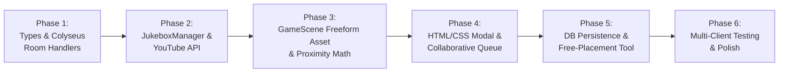

# YouTube Jukebox Implementation Plan

A comprehensive architectural and engineering plan for adding a synchronized, collaborative **YouTube Jukebox** to **Lepark**.

---

## 1. Executive Summary & Goals

The YouTube Jukebox brings shared background music to spaces in Lepark:
* **Dedicated World Asset:** Uses [/assets/jukebox_150.png](file:///Users/firdausfadzi/Desktop/game/assets/jukebox_150.png) (150×150 px PNG).
* **Decoration Category Asset:** Available in the Map Editor sidebar under the **Decoration** category alongside other room furnishings.
* **Unbounded Free-Placement (Grid-Free):** 
  * Unlike regular floor or decorative tiles, the jukebox is **not bounded by the grid** and does **not rearrange or overwrite the tile map**.
  * It can be placed at any continuous pixel world coordinates $(X, Y)$ (freeform placement / drag-and-drop), giving players complete freedom to place it anywhere inside a room or public square.
* **Empty Playlist by Default:** Starts with an empty queue and awaits user-submitted music.
* **Continuous Looping:** Once tracks exist, the playlist loops indefinitely ($(\text{index} + 1) \bmod N$).
* **Collaborative Control:** Any player in the space can add YouTube tracks (via full URL or Video ID) and remove tracks from the queue.
* **Acoustic Zone Isolation & Spatial Audio:**
  * **Private Area:** If the jukebox is located inside a private zone, there is **no proximity distance falloff**. Everyone inside that private room hears the music uniformly (100% volume). Players outside the private zone cannot hear it (0% volume).
  * **Public Area:** If the jukebox is placed in a public area, it uses proximity audio calculation (1 tile = 100%, 8 tiles = 0%, smooth cosine rolloff). Players inside private rooms cannot hear public jukeboxes.

---

## 2. High-Level Architecture

```mermaid
flowchart TD
    subgraph Client["Client (Phaser 3 + HTML5 UI)"]
        UI["Jukebox Modal & HUD<br/>(Queue, Add URL, Remove Track)"]
        YT["YouTube IFrame Player<br/>(YT.Player API)"]
        Scene["GameScene (Phaser)<br/>- Freeform Jukebox Sprite (/assets/jukebox_150.png)<br/>- Proximity & Zone Audio Attenuation<br/>- Animated Musical Notes Particle Effect"]
        NetClient["MultiplayerManager<br/>(Colyseus Client)"]
    end

    subgraph Server["Multiplayer Server (Colyseus + Node.js)"]
        Room["GameRoom<br/>- Authoritative Playlist State & Loop Timer<br/>- Unbounded World (X, Y) Coordinates<br/>- Message Handlers"]
        DB["PostgreSQL / In-Memory Store<br/>- Space Jukebox Persistence"]
    end

    UI -->|Add / Remove / Skip| NetClient
    NetClient -->|WebSocket Messages| Room
    Room -->|JUKEBOX_UPDATED State Sync| NetClient
    NetClient -->|State Sync Event| Scene
    NetClient -->|State Sync Event| UI

    Scene -->|Calculated Volume (0.0 - 1.0)| YT
    Room -->|Save Jukebox Config| DB
```

---

## 3. Data Structures & Shared Protocol

### 3.1. Shared Interfaces (`shared/src/types.ts`)

```typescript
export interface JukeboxTrack {
  id: string;              // Unique track queue ID (UUID)
  youtubeId: string;       // 11-char YouTube Video ID (e.g. "dQw4w9WgXcQ")
  title: string;           // Video title (fetched via oEmbed or URL fallback)
  duration: number;        // Track duration in seconds
  addedBySessionId: string;// Colyseus session ID
  addedByName: string;     // Player display name
  addedAt: number;         // Timestamp added
}

export interface JukeboxState {
  id: string;              // Jukebox entity ID
  spaceId: string;         // Space ID where jukebox is located
  x: number;               // Freeform world X coordinate (pixels, NOT snapped to grid)
  y: number;               // Freeform world Y coordinate (pixels, NOT snapped to grid)
  isPlaying: boolean;      // Playback active
  currentTrackIndex: number; // Current index in playlist
  trackStartedAt: number;  // Server timestamp (ms) when current track started
  playlist: JukeboxTrack[];// Collaborative queue
}

// Client -> Server Payloads
export interface JukeboxAddTrackPayload {
  jukeboxId: string;
  urlOrId: string;
}

export interface JukeboxRemoveTrackPayload {
  jukeboxId: string;
  trackId: string;
}

export interface JukeboxSkipPayload {
  jukeboxId: string;
}

export interface JukeboxPlacePayload {
  x: number;               // Freeform world X (pixels)
  y: number;               // Freeform world Y (pixels)
}

export interface JukeboxMovePayload {
  jukeboxId: string;
  x: number;               // Freeform world X (pixels)
  y: number;               // Freeform world Y (pixels)
}

export interface JukeboxDeletePayload {
  jukeboxId: string;
}
```

### 3.2. Colyseus Protocol Events
| Event Name | Direction | Payload | Description |
|---|---|---|---|
| `JUKEBOX_ADD_TRACK` | Client $\rightarrow$ Server | `{ jukeboxId, urlOrId }` | Validates YouTube ID, extracts metadata, appends to playlist |
| `JUKEBOX_REMOVE_TRACK` | Client $\rightarrow$ Server | `{ jukeboxId, trackId }` | Removes track from queue, shifts active index if needed |
| `JUKEBOX_SKIP_TRACK` | Client $\rightarrow$ Server | `{ jukeboxId }` | Manually advances to next track in loop |
| `JUKEBOX_PLACE` | Client $\rightarrow$ Server | `{ x, y }` | Places a new jukebox at freeform coordinates (owner/admin) |
| `JUKEBOX_MOVE` | Client $\rightarrow$ Server | `{ jukeboxId, x, y }` | Moves jukebox to new freeform coordinates (owner/admin) |
| `JUKEBOX_DELETE` | Client $\rightarrow$ Server | `{ jukeboxId }` | Removes jukebox from space (owner/admin) |
| `JUKEBOX_STATE_SYNC` | Server $\rightarrow$ Client | `JukeboxState[]` | Initial sync when player joins the room |
| `JUKEBOX_UPDATED` | Server $\rightarrow$ Client | `JukeboxState` | Broadcast to all clients when playlist, position, or playback changes |

---

## 4. Server-Side Authoritative Playlist Engine

File: `server/src/rooms/GameRoom.ts`

### 4.1. Playlist State Lifecycle & Auto-Advance
1. **Initial State:** Empty playlist `[]`, `isPlaying = false`, `currentTrackIndex = 0`.
2. **First Track Added:**
   * When a player submits the first URL, `playlist.push(track)`, `isPlaying = true`, `currentTrackIndex = 0`, `trackStartedAt = Date.now()`.
   * Server broadcasts `JUKEBOX_UPDATED`.
3. **Looping Logic:**
   * Server maintains a tick / timer checking playback progress:
     $$\text{elapsed} = \frac{\text{Date.now()} - \text{trackStartedAt}}{1000}$$
   * When $\text{elapsed} \ge \text{currentTrack.duration}$, advance index:
     $$\text{currentTrackIndex} = (\text{currentTrackIndex} + 1) \bmod \text{playlist.length}$$
     $$\text{trackStartedAt} = \text{Date.now()}$$
   * Broadcasts `JUKEBOX_UPDATED`. If playlist has 1 song, it loops that single song seamlessly.
4. **Track Removal:**
   * If a user removes track at index $i$:
     * If $i < \text{currentTrackIndex}$, `currentTrackIndex--`.
     * If $i == \text{currentTrackIndex}$, the current song stops and immediately advances to the next track:
       $$\text{currentTrackIndex} = \text{currentTrackIndex} \bmod \text{newPlaylist.length}$$
       $$\text{trackStartedAt} = \text{Date.now()}$$
     * If the playlist becomes empty: `isPlaying = false`, `currentTrackIndex = 0`, `trackStartedAt = 0`.
5. **Metadata Extraction:**
   * Extracts the YouTube Video ID using regex:
     `/(?:youtube\.com\/(?:[^\/]+\/.+\/|(?:v|e(?:mbed)?)\/|.*[?&]v=)|youtu\.be\/)([^"&?\/\s]{11})/i`
   * Fetches title via YouTube's public oEmbed endpoint (`https://www.youtube.com/oembed?url=...&format=json`) without requiring a Google API Key.

---

## 5. Audio Attenuation & Zone Isolation Rules

File: `client/src/scenes/GameScene.ts`

The audio attenuation precisely follows the existing proximity calculation used for player voice chat in [GameScene.ts](file:///Users/firdausfadzi/Desktop/game/client/src/scenes/GameScene.ts#L1182-L1212).

### 5.1. Acoustic Matrix

```
                          ┌────────────────────────┐
                          │   Jukebox Location     │
                          ├───────────┬────────────┤
                          │  Private  │   Public   │
┌───────────────┬─────────┼───────────┼────────────┤
│               │ Same    │   100%    │    0%      │
│               │ Private │  Uniform  │  (Muted)   │
│ Local Player  ├─────────┼───────────┼────────────┤
│ Location      │ Diff    │    0%     │    0%      │
│               │ Private │  (Muted)  │  (Muted)   │
│               ├─────────┼───────────┼────────────┤
│               │ Public  │    0%     │ Proximity  │
│               │ Area    │  (Muted)  │  Rolloff   │
└───────────────┴─────────┴───────────┴────────────┘
```

### 5.2. Mathematical Calculation (Grid-Free Coordinates)

Because the jukebox has continuous world pixel coordinates $(jx, jy)$:

1. **Private Zone Check:**
   Convert $(jx, jy)$ to grid cells to detect if it resides inside any private zone:
   $$\text{jCol} = \lfloor jx / \text{TILE\_SIZE} \rfloor$$
   $$\text{jRow} = \lfloor jy / \text{TILE\_SIZE} \rfloor$$
   Check if $(\text{jCol}, \text{jRow})$ falls within `[minCol, maxCol]` and `[minRow, maxRow]` of any `privateZones`.

2. **Attenuation Logic:**
```typescript
// Inside GameScene.ts update() loop:
const jx = jukebox.x;
const jy = jukebox.y;
const jCol = Math.floor(jx / TILE_SIZE);
const jRow = Math.floor(jy / TILE_SIZE);

// Check if jukebox is located inside any private zone
const jukeboxZone = this.privateZones.find(
  (z) =>
    jCol >= z.bounds.minCol &&
    jCol <= z.bounds.maxCol &&
    jRow >= z.bounds.minRow &&
    jRow <= z.bounds.maxRow
) || null;

const localZone = this.currentInsideZone;
let volume = 0.0;

if (jukeboxZone) {
  // Case A: Jukebox is in a private area -> NO proximity audio
  if (localZone && localZone.id === jukeboxZone.id) {
    // Player is inside the SAME private area: everyone hears the same uniform sound
    volume = 1.0;
  } else {
    // Player is outside this private area (in public or another room): inaudible
    volume = 0.0;
  }
} else {
  // Case B: Jukebox is in a public area -> Proximity audio identical to player calculation
  if (localZone) {
    // Player is inside a private area: shielded from public jukebox audio
    volume = 0.0;
  } else {
    // Both player and jukebox are in public: calculate Euclidean distance
    const dist = Phaser.Math.Distance.Between(playerX, playerY, jx, jy);
    const MIN_DIST = 1 * TILE_SIZE; // 50px: 100% volume
    const MAX_DIST = 8 * TILE_SIZE; // 400px: 0% volume (inaudible)

    if (dist <= MIN_DIST) {
      volume = 1.0;
    } else if (dist >= MAX_DIST) {
      volume = 0.0;
    } else {
      // Smooth cosine rolloff curve (identical to player voice chat)
      const factor = (dist - MIN_DIST) / (MAX_DIST - MIN_DIST);
      volume = Math.cos(factor * (Math.PI / 2));
    }
  }
}

// Apply calculated volume scaled by master user volume
jukeboxManager.setProximityVolume(jukebox.id, volume);
```

---

## 6. YouTube IFrame Player & Client Audio Manager

File: `client/src/audio/JukeboxManager.ts`

### 6.1. YouTube IFrame API Integration
* Dynamically loads `https://www.youtube.com/iframe_api`.
* Initializes an off-screen/embedded iframe player container:
  ```html
  <div id="youtube-jukebox-container" class="youtube-player-hidden">
    <div id="youtube-jukebox-iframe"></div>
  </div>
  ```
* Controlled via `YT.Player`:
  * `player.loadVideoById({ videoId, startSeconds })`
  * `player.setVolume(Math.round(volume * userMasterVolume * 100))`
  * `player.seekTo(currentTrackElapsed, true)`

### 6.2. Autoplay Policy & Audio Unlocking
* Web browsers block audio playback until user interaction.
* If playback fails due to autoplay policy:
  * Display a discreet HUD notification or chip: `🔊 Click to Tune In to Jukebox`.
  * Single tap on canvas or HUD starts playback and sets correct volume.

### 6.3. Volume Update Throttling
* Phaser runs at 60 FPS; setting IFrame volume 60 times a second can cause postMessage lag.
* Implement a 10 Hz rate limiter and deadzone check ($\Delta\text{volume} > 0.01$) before dispatching `setVolume` to the YouTube player.

---

## 7. Phaser Game World & Jukebox Freeform Asset

File: `client/src/scenes/GameScene.ts`

### 7.1. Asset Loading & Rendering
* **Asset Path:** `/assets/jukebox_150.png` (150×150 px PNG).
* In `preload()`:
  ```typescript
  this.load.image("jukebox_150", "/assets/jukebox_150.png");
  ```
* In `create()` / entity manager:
  * Spawn as an independent Phaser Container or Sprite at world coordinates `(x, y)`:
    ```typescript
    const sprite = this.add.image(0, 0, "jukebox_150");
    sprite.setDisplaySize(48, 48); // or proportionate display scaling
    const container = this.add.container(x, y, [sprite]);
    container.setDepth(y); // Y-sorting so avatars render naturally in front or behind it
    ```
* **Grid Independence:**
  * Jukebox is **not** part of `tileImages` or `decorationImages` grids.
  * It does **not** overwrite floor tiles, grass, carpets, or walls.
  * Players can position it anywhere (in a corner, along a wall, or in the center of a dancefloor).

### 7.2. Animated Feedback & Interaction Trigger
* **Floating Musical Notes:**
  * Floating pixel musical notes (`♪`, `♫`, `🎵`) spawned above the jukebox when `isPlaying === true`.
* **Proximity Interaction & Click:**
  * Clickable interactive zone on the sprite container.
  * Proximity prompt `[E] Open Jukebox` appears when local player is within 1.5 tiles (72px) of $(jx, jy)$.

### 7.3. Map Editor Free-Placement Tool
* When the "Jukebox" tool is selected in Edit Mode:
  * A ghost/preview of `jukebox_150` follows `pointer.worldX, pointer.worldY` **without snapping to grid lines**.
  * Clicking places or moves the jukebox at the exact pointer position.
  * Delete/Move handles allow space owners to reposition or remove jukeboxes.

---

## 8. Frontend UI / UX Components

File: `client/index.html`, `client/src/style.css`, `client/src/main.ts`

### 8.1. Jukebox Modal (`#jukebox-modal`)
* **Header:**
  * Jukebox title with space name and close button `[✕]`.
* **Now Playing Card:**
  * Video thumbnail & animated equalizer bars.
  * Track title & artist/uploader.
  * Submitter info (`Added by PlayerName`).
  * Time progress bar (`01:23 / 03:45`).
  * Skip button `[⏭ Skip Track]`.
* **Add Track Input:**
  * Text input placeholder: `"Paste YouTube link or Video ID (e.g. https://youtu.be/...)"`.
  * Submit button: `"Add to Playlist"`.
  * Validation / error badge (e.g. invalid URL, already in queue).
* **Playlist Queue:**
  * Scrollable list of tracks.
  * Each item shows: `#`, thumbnail preview, title, duration, who added it, and a `[🗑️ Remove]` button accessible to all players.
  * Empty State message: *"The playlist is empty. Add a YouTube link above to start playing music!"*

### 8.2. Floating HUD Mini-Player
* When inside hearing range, a compact pill on the HUD displays:
  `🎶 Now Playing: Track Title • Volume [ ──●── ]`
  Clicking the pill opens the full Jukebox modal.

---

## 9. Database & Space Persistence

File: `server/src/db/index.ts`

To persist jukeboxes across room restarts and server reboots:
* Add `jukeboxes JSONB DEFAULT '[]'::jsonb` column to the `spaces` table.
* On room load: `getSpaceJukeboxes(spaceId)` loads placed jukeboxes with continuous coordinates:
  ```json
  [
    {
      "id": "jukebox_1",
      "x": 482.5,
      "y": 320.0,
      "playlist": []
    }
  ]
  ```
* On update: `updateSpaceJukeboxes(spaceId, jukeboxes)` persists coordinates and playlist.

---

## 10. Step-by-Step Implementation Roadmap



### Phase 1: Shared Models & Colyseus Server Engine
1. Update [shared/src/types.ts](file:///Users/firdausfadzi/Desktop/game/shared/src/types.ts) with `JukeboxTrack`, `JukeboxState`, and free-coordinate payloads (`x: number, y: number`).
2. In [server/src/rooms/GameRoom.ts](file:///Users/firdausfadzi/Desktop/game/server/src/rooms/GameRoom.ts):
   * Add `jukeboxes: Map<string, JukeboxState>` to room state.
   * Implement handlers: `JUKEBOX_ADD_TRACK`, `JUKEBOX_REMOVE_TRACK`, `JUKEBOX_SKIP_TRACK`, `JUKEBOX_PLACE`, `JUKEBOX_MOVE`, `JUKEBOX_DELETE`.
   * Implement auto-advance timer for looping playback.
   * Broadcast updates to clients via `JUKEBOX_UPDATED`.

### Phase 2: Client YouTube Engine & Audio Controller
1. Create `client/src/audio/JukeboxManager.ts`:
   * Load YouTube IFrame API asynchronously.
   * Manage player lifecycle (create, cue, play, pause, volume, time sync).
   * Implement rate-limited volume updater.

### Phase 3: Spatial Audio & Freeform GameScene Integration
1. In [client/src/scenes/GameScene.ts](file:///Users/firdausfadzi/Desktop/game/client/src/scenes/GameScene.ts):
   * Preload `/assets/jukebox_150.png`.
   * Render free-placement jukebox container at world $(x, y)$ with Y-depth sorting.
   * Add musical note particle emitters when `isPlaying === true`.
   * Add proximity audio calculation loop in `update()`:
     * Convert $(jx, jy)$ to grid cells to detect if inside any `privateZones`.
     * Private zone: check if jukebox and player are in the same zone $\rightarrow$ $1.0$ vs $0.0$.
     * Public area: check if player is public $\rightarrow$ cosine distance rolloff between $1 \times \text{TILE\_SIZE}$ and $3 \times \text{TILE\_SIZE}$ using Euclidean distance.
   * Add interaction hit-zone / keypress `[E]` to trigger UI modal.

### Phase 4: Collaborative UI & Queue Management
1. In [client/index.html](file:///Users/firdausfadzi/Desktop/game/client/index.html) and [client/src/style.css](file:///Users/firdausfadzi/Desktop/game/client/src/style.css):
   * Add Jukebox Modal markup with Now Playing, URL input form, and scrollable playlist queue.
2. In [client/src/main.ts](file:///Users/firdausfadzi/Desktop/game/client/src/main.ts):
   * Wire modal open/close handlers.
   * Wire "Add Song" form with URL parsing and Colyseus dispatch.
   * Wire "Remove Song" buttons for all users in the queue.
   * Handle empty playlist UI state and live queue updates.

### Phase 5: Free-Placement Map Editor Tool & Database Persistence
1. Add Jukebox tool to the Map Editor palette with unconstrained cursor-following (grid-free placement).
2. Persist jukebox placement and playlist queue in `spaces.jukeboxes` in [server/src/db/index.ts](file:///Users/firdausfadzi/Desktop/game/server/src/db/index.ts).

### Phase 6: Edge Cases & Verification
1. Test freeform placement anywhere on the map without affecting bottom tiles or decorations.
2. Test single-track looping, multi-track looping, and transitions when the last track finishes.
3. Test concurrent multi-user additions and deletions.
4. Verify private zone audio cutoff:
   * Jukebox placed at freeform coordinates inside a private room: audible everywhere inside the room; silent immediately upon stepping outside.
   * Jukebox placed in public area: fades out smoothly over 3 tiles (144px); muted when stepping into an adjacent private room.
5. Test invalid or copyright-restricted YouTube links with graceful error handling and auto-skip.
